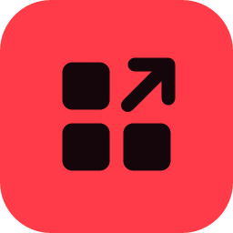
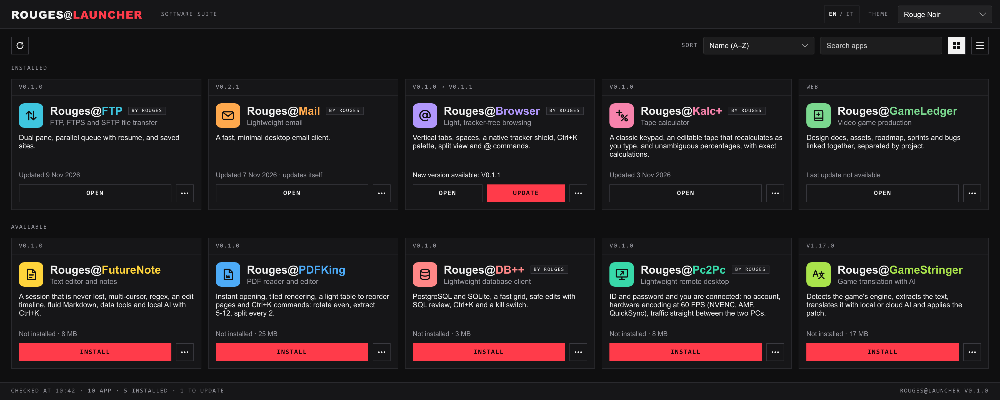

<p align="center">
  
</p>

<h1 align="center">Rouges Suite</h1>

<p align="center">
  <b>Small, fast apps for Windows.</b><br>
  Install one launcher, pick your apps, and they stay up to date by themselves.
</p>

<p align="center">
  <a href="https://github.com/rouges78/Rouges-Suite/releases/latest/download/RougesSetup.exe">
    
  </a>
</p>
<p align="center"><sub>Windows 10 and 11 · English and Italian</sub></p>

<p align="center">
  <picture>
    <source media="(prefers-color-scheme: dark)" srcset="assets/screenshot-dark.png">
    <source media="(prefers-color-scheme: light)" srcset="assets/screenshot-light.png">
    
  </picture>
</p>

## Get started

1. **Download** `RougesSetup.exe` with the button above.
2. **Open it.** The launcher installs itself and opens. No wizard, no admin rights.
3. **Pick your apps** and click **INSTALL**. That's it.

> [!NOTE]
> **"Windows protected your PC"?** The setup is not code-signed yet, so the first time Windows SmartScreen may show
> this. Click **More info → Run anyway**. It happens only once: the apps and every update are downloaded by the
> launcher, without the warning.

<details>
<summary><b>Prefer no warning at all?</b> Install from PowerShell</summary>

```powershell
irm https://raw.githubusercontent.com/rouges78/Rouges-Suite/main/install.ps1 | iex
```

It downloads the same `RougesSetup.exe`, checks its SHA-256 and runs it.
</details>

## The apps

| | App | |
|:-:|---|---|
|  | **Rouges-FTP** | FTP, FTPS and SFTP file transfer: dual pane, parallel queue with resume, saved sites. |
|  | **Rouges-LightMail** | Lightweight email: a fast, minimal desktop client. |
|  | **Rouges-Browser** | Light, tracker-free browsing: vertical tabs, spaces, a native tracker shield, split view. |
|  | **Rouges-FutureNote** | Text editor and notes: a session that is never lost, multi-cursor, fluid Markdown, local AI. |
|  | **Rouges-PDFKing** | PDF reader and editor: instant opening, a light table to reorder pages, OCR. |
|  | **Rouges-DB** | Lightweight database client: PostgreSQL and SQLite, fast grid, safe edits with SQL review. |
|  | **Rouges-Pc2Pc** | Lightweight remote desktop: ID and password, no account, hardware encoding at 60 FPS. |
|  | **Rouges-Kalc+** | Tape calculator: an editable tape that recalculates as you type, exact calculations. |
|  | **Rouges-PlayVideo** | Video player: any format up to 4K HDR with hardware decoding, seek-bar previews, subtitles and A-B loop. |
|  | **Rouges-VideoEnhancer** | AI video upscaling and frame interpolation: Real-ESRGAN and RIFE on the GPU, a live before/after preview. |
|  | **Rouges-ScanLanPc** | LAN scanner and PC diagnostics: finds the devices on the network in seconds, recognises their role and audits Windows PCs: hardware, software to update and health. |
|  | **Rouges-GameLedger** | Video game production, in the browser: design docs, assets, roadmap, sprints and bugs linked together, separated by project. |

## Why a launcher

- **One click per app.** Install, open, update and uninstall each app from its card. Web apps, like
  Rouges-GameLedger, simply open in your browser: there is nothing to install.
- **Always up to date.** A new version shows up as **UPDATE**; the launcher updates itself too.
- **Clean.** Apps live in `%LOCALAPPDATA%\Rouges`, with a Start menu shortcut and a normal entry in
  *Settings → Apps → Installed apps*. No admin rights, no services, nothing running in the background.
- **Safe.** The app catalog is signed and every package is checked (see below).
- **Yours.** English or Italian, and 11 themes, high contrast included.

## Security

The app catalog (`catalog.json`) is signed: the launcher accepts it only with a valid signature
(`catalog.json.sig`) and only if it is not older than the one it already has. Each package is installed only if its
SHA-256 matches the catalog, and only from `https://` addresses.

## Made with Slint

Rouges-Launcher, Rouges-FTP, Rouges-FutureNote, Rouges-PDFKing, Rouges-Pc2Pc and Rouges-Kalc+ are built with
[Slint](https://slint.dev), used under the Slint Royalty-free License.

<a href="https://slint.dev"></a>
